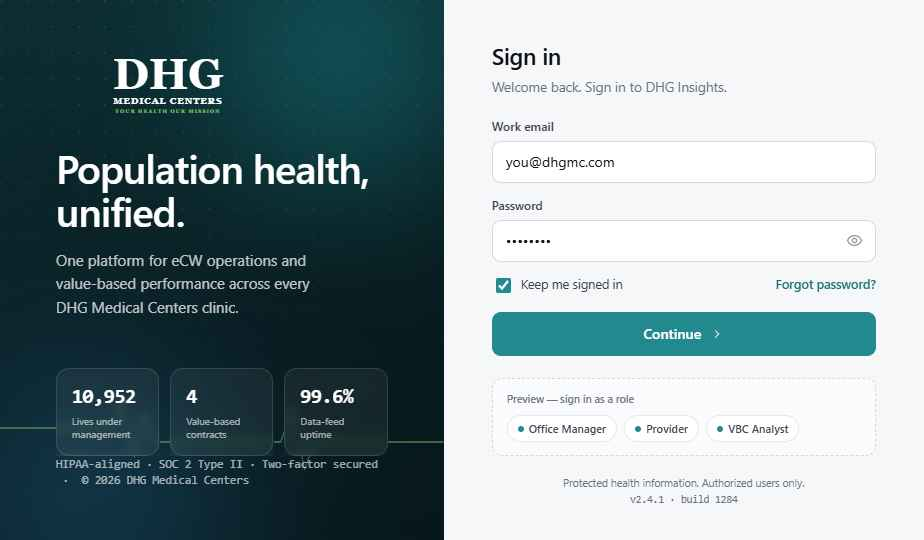
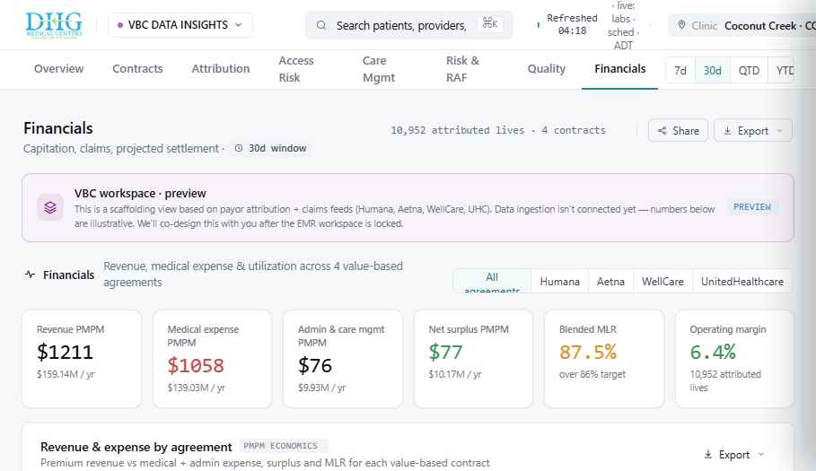
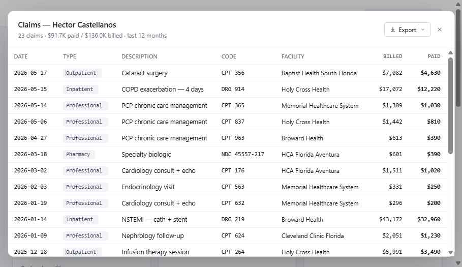
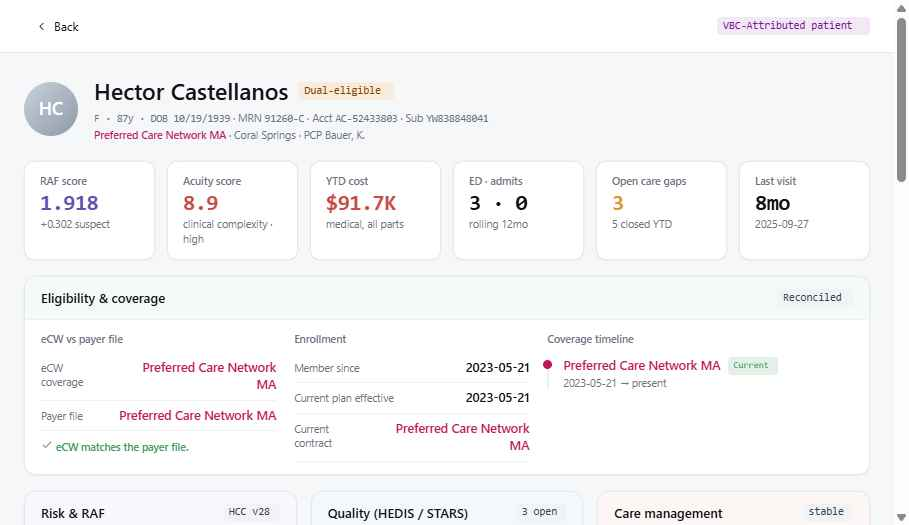
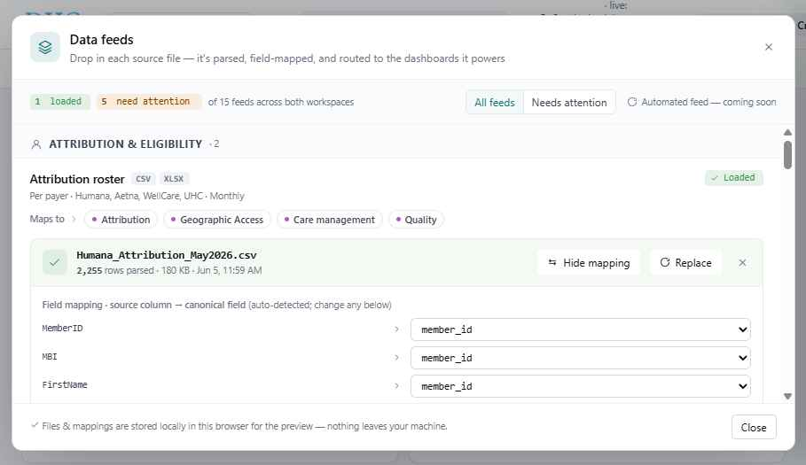
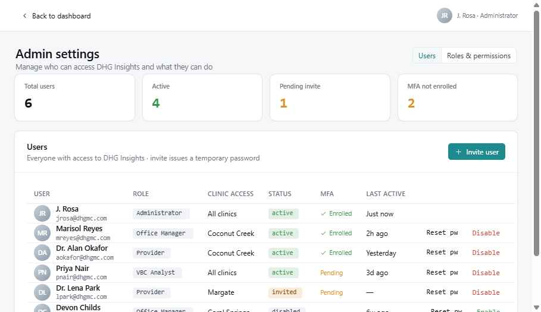
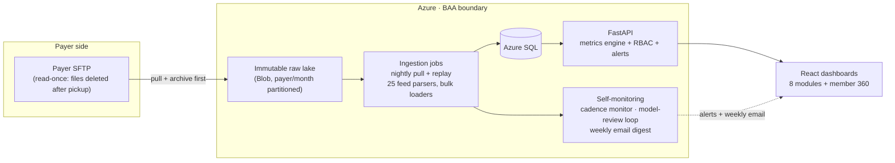

# Value-Based Care Analytics Platform — Case Study

A production healthcare analytics platform I built for **Doctors Health Group** (South Florida), a primary-care group operating **full-risk Medicare Advantage contracts**. It turns raw payer data feeds — eligibility, claims, pharmacy, revenue/risk scores, inpatient census, fund statements, HEDIS quality reports; 25 feed types in all — into the operating dashboards a value-based-care organization runs on: attribution, care management, risk adjustment, quality, and contract financials, down to a full **360° profile of every member**.

> **This is a case study of a private production system.** The full source is proprietary; this repo carries the architecture, sanitized excerpts of the two most distinctive subsystems, and screenshots. **All screenshots show synthetic demo data** — production runs against real payer feeds entirely inside a BAA-covered Azure boundary, and no PHI has ever existed in the source repository. Happy to walk through the full codebase live.

| | |
|---|---|
|  |  |
|  |  |
|  |  |

## The three difference-makers

### 1 · One care-management platform across payer partners

Most groups at risk run a separate spreadsheet universe per payer contract. Here, every payer feed lands in **one canonical data model**, so care management operates on *patients*, not file formats: a single transitions-of-care worklist with per-measure HEDIS clocks, a single daily inpatient census, a single 1–10 acuity risk register, and a **member 360** that assembles everything the organization knows about one person — eligibility timeline, risk scores, claims, pharmacy + adherence, quality gaps, admissions, engagement, fund P&L, cost projection — on one page, regardless of which payer the data came from. Two full-risk contracts are live today; the pipeline is payer-pluggable by design (a payer registry + parser mappings, and a standing product rule of *no per-payer dashboards*), with three more payers in onboarding. Adding a payer makes every existing workflow richer instead of adding another silo.

### 2 · Predictive cost modeling built like an actuarial instrument

A **living, versioned formula** — not a black box: baseline = member risk score × the book's own cost-rate-per-RAF derived from the payer's fund actuals; a credibility-weighted utilization trajectory; transparent modifier flags; calibration that redistributes but never invents dollars. Every active member gets a projection with a confidence band — sparse-data members are *flagged*, never silently precise. Because the same fund data carries revenue, the model runs **contract economics end-to-end: actual and projected net surplus/deficit**, per member and for the book, alongside cost. Nightly snapshots create a permanent projected-vs-actual audit trail, and accuracy + bias metrics are displayed on the dashboard itself rather than hidden in a notebook.

### 3 · AI agents that improve the model as data arrives

The model carries its own accountability loop. **After every claims or fund-statement load, an agent re-scores every stored projection against the new actuals**, hunts for bias cohorts across six dimensions (risk-score band, data sufficiency, plan, tenure, utilization flags), and files **versioned tweak proposals with the evidence attached** — a human approves, then the change ships as the next formula version with its own audit trail. The loop's very first run caught a real defect: a sparse-data cohort running ~78% over-projected, with a concrete threshold fix proposed. Sibling agents watch the data supply itself (a cadence monitor that learns each feed's delivery rhythm and catches feeds whose *content* silently stops advancing even while files keep arriving — a real payer-side failure it now detects automatically) and run a **weekly automated code review + performance audit** of the codebase — the whole system emails its operator a Monday diagnostics digest.

**→ Sanitized excerpts of both agents are in [`excerpts/`](excerpts/)** — the cadence monitor and the model-review loop, adapted from production with identifiers genericized.

## Architecture

**Key design decisions**

- **Archive-first, immutable lake.** The payer's SFTP is read-once; the blob lake is the only durable copy of source truth. Parser fixes are applied by *replaying* from the lake — never by re-pulling. Onboarding a new payer = credentials + parser mappings.
- **Statement of record vs. observed overlay.** The payer's monthly fund statement is authoritative; claims-derived figures are the *observed* overlay, reconciled against it with per-month completion percentages on screen. Months qualify for model math only when member-level allocation reconciles ≥80% to the statement.
- **Payload error boundaries.** Every dashboard sub-section is individually guarded server-side — one failing overlay degrades to that section's honest empty state instead of blanking the app.
- **Role-based access on top of enterprise SSO.** Microsoft Entra assignment-locks who can *enter*; an admin-managed in-app role table (with a break-glass allowlist) governs what each user can *use*, per module, with a disabled-user kill switch and an append-only audit trail whose actor identity is derived server-side from the auth principal — never trusted from the client.
- **Honesty as a product rule.** Views bind to live payer data and degrade to explicit empty states when a feed hasn't delivered; every incomplete month, lagging claim, and unvalidated signal is labeled as exactly that. No number on screen is fabricated.

## Hard-won production lessons (encoded in the code)

These are the defect classes that produce *wrong clinical and financial numbers* rather than stack traces — each was found in production, root-caused, and turned into a standing rule:

- **Payer files restate history.** The monthly revenue file re-reports prior member-months (originals + retro adjustments); naive aggregation double-counted sicker members and overstated payments ~3.8×. Correct math keys by *coverage month, latest cycle wins* — and mid-year CMS reconciliation sweeps will book phantom terminated members into current months if you key by payment cycle instead.
- **Claims files restate claim IDs across files**, so per-file idempotency deadlocks against the primary key — loaders need cross-file supersede (newest file wins), and replay order matters.
- **Dialect parity is a trap.** Tests on SQLite pass SQL that the production database rejects. Every new query is audited for T-SQL compatibility before deploy.
- **Index budgets on big tables.** Five secondary indexes crawled a 1.2M-row load into a job timeout; two survived. Read paths aggregate server-side — one raw table scan once took a cold dashboard load to 3.5 minutes.
- **Duplicates are endemic to healthcare data** — but every feed has a different grain (eligibility = member-months; claims = line items, legitimately multi-row). Dedupe by natural key per feed; never blanket-dedupe.

## Stack

| Layer | Choice | Why |
|---|---|---|
| Cloud | Azure (Container Apps, SQL, Blob, Key Vault, Entra ID, Communication Services) | BAA-covered end to end |
| Backend | Python · FastAPI · SQLAlchemy | data engineering *is* the product |
| Ingestion | Custom pipeline: SFTP → immutable lake → typed loaders (streaming bulk inserts) | 25 heterogeneous feed formats incl. raw CMS record layouts |
| Frontend | React dashboards (design-system prototype; Next.js + TypeScript migration planned) | velocity now, typed contracts at productization |
| Ops | Nightly ingestion jobs · self-monitoring agents · weekly email digest · CI · scheduled AI code-review agent | the platform watches itself |

## Status & role

Live in production: full real dataset for two at-risk Medicare Advantage contracts (members, multi-year eligibility history, claims, pharmacy, revenue/RAF, labs, authorizations, inpatient census, fund statements, HEDIS), all eight dashboard modules, self-monitoring + weekly ops loop running. Roadmap: user onboarding + SSO bridge → three additional payers → EMR clinical feed integration → multi-tenant productization.

I designed and built the platform end to end — architecture, ingestion pipeline, metrics engine, dashboards, monitoring agents, and the Azure environment — using AI-assisted engineering (Claude) as a force multiplier, with every deployment human-verified against production data.

---

*© 2026 Juan Rosa. Shared for portfolio review — not licensed for reuse. No PHI: all patient-shaped data in this repository and its screenshots is synthetic.*
