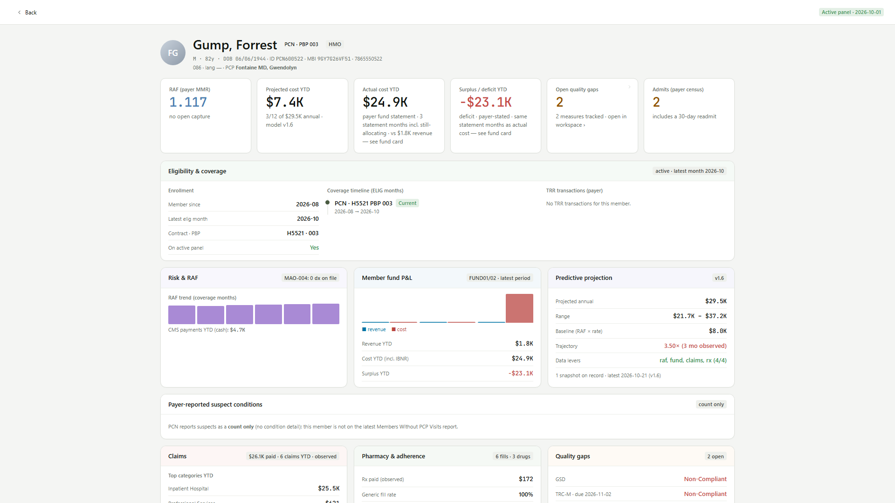
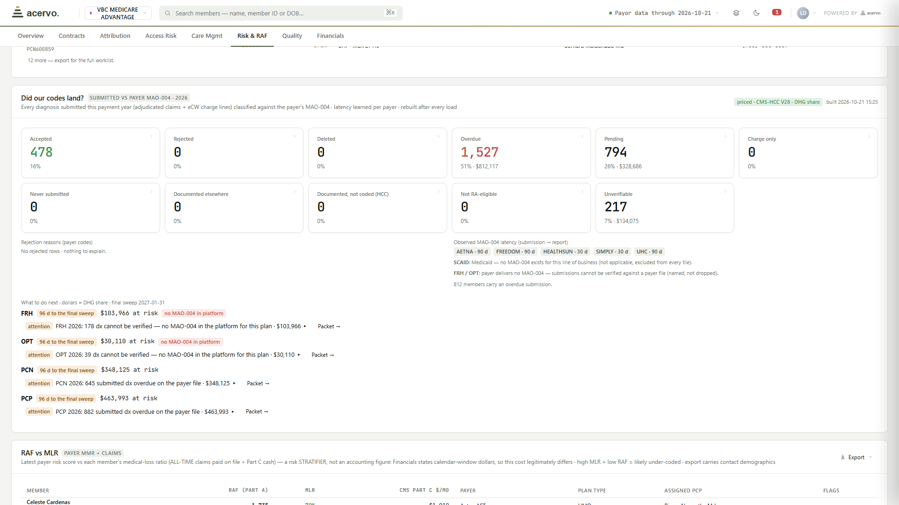
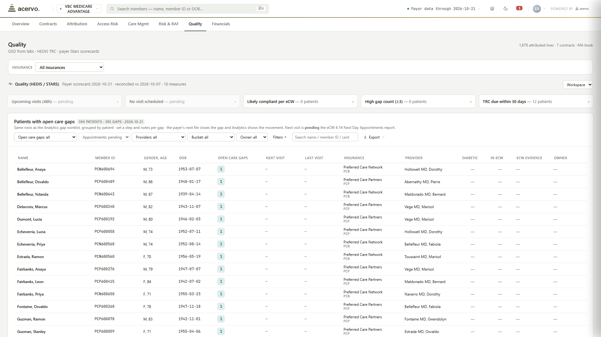
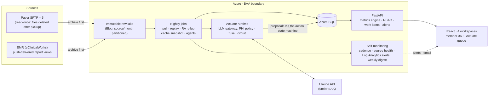

# Value-Based Care Analytics Platform — Case Study

A production healthcare analytics **and AI-agent** platform I built for **Doctors Health Group** (South Florida), a primary-care group operating **full-risk Medicare Advantage contracts** — now being productized as **Acervo Health**. It turns raw payer data feeds — eligibility, claims, pharmacy, revenue/risk scores (MMR), CMS MAO-004 encounter acceptance reports, payer-reported suspect conditions, inpatient census and ADT events, fund statements, HEDIS quality reports; **60+ feed types across five payer integrations** — plus a push-delivered **eClinicalWorks EMR feed** (encounters, charge lines, claim submissions and status, assessment diagnoses) into the operating system a value-based-care organization runs on: **four workspaces** (clinical operations, the Medicare Advantage book, the Medicaid book, and an AI-agent work queue), a full **360° profile of every member**, and a **nightly agent layer** that audits risk adjustment against CMS's own acceptance records, decodes every fund statement, and explains feed problems — every output a draft for a human to decide.

> **This is a case study of a private production system.** The full source is proprietary; this repo carries the architecture, sanitized excerpts of two foundational subsystems, and screenshots. **All screenshots show synthetic demo data** — production runs against real payer feeds entirely inside a BAA-covered Azure boundary, and no PHI has ever existed in the source repository. Happy to walk through the full codebase live.

| | |
|---|---|
|  |  |
|  |  |
|  |  |
|  |  |

*Screenshots (captured October 2026) show the productized demo tenant ("Palmetto Care Partners" — a fictional organization) on entirely synthetic data.*

## What it does for the organization

A medical group at full risk for Medicare Advantage members is effectively running a small insurance company: it earns capitated premium, pays medical claims out of its own fund, and lives or dies on risk-score accuracy, quality stars, and utilization management. The payer sends the raw truth — as dozens of pipe-delimited files, spreadsheets, and CMS record formats on SFTP servers that delete files after pickup — and the practice's own EMR holds the other half of the story. Most groups reconcile the two in spreadsheets, weeks behind. This platform ingests all of it nightly and turns it into work:

| Workspace | What the team gets | Why it matters |
|---|---|---|
| **EMR Data Insights** (clinical ops) | Who was seen, where, by whom, under which insurance, and what was billed with which diagnoses and CPT codes — read live from the EMR feed. Provider scorecards (visits/week, panel size, no-show proxy) compared only across the organization's actual roster of centers and providers; access & scheduling risk; case management; an in-app documentation hub. Every number is labeled **live**, **proxy**, or **pending**. | The practice sees its own operations the morning after, without waiting on the payer, and without a report that quietly compares a closed clinic to an open one. |
| **VBC Medicare Advantage** and **VBC Medicaid** books | Eight tabs per book — Overview · Contracts · Attribution · Access Risk · Care Mgmt · Risk & RAF · Quality · Financials — all payer-agnostic by construction (the payer is a filter, never a separate dashboard). The Medicaid book shows an explicit *not applicable* where a Medicare-only measure doesn't apply, never a zero. | One operating picture per line of business across every contract, instead of one spreadsheet universe per payer. |
| → **Attribution** | Who our members are right now, who is new, who is leaving — and, since October 2026, each member's **home center and provider derived from the EMR encounter data** (nightly, with a twelve-month backfill), reconciled against what each payer thinks. | The payer's attribution file and the practice's reality finally meet on one page. |
| → **Care management** | One transitions-of-care worklist with per-measure HEDIS clocks, one daily inpatient census plus ADT event digest, one acuity risk register — with each payer's discharge semantics declared explicitly, not guessed. | Universal care management: a new payer or a hospital ADT feed makes the worklist richer, not longer. |
| → **Risk & RAF** | The **full risk-adjustment chain audited end to end**: documented in the chart → charged → claimed → clearinghouse status → accepted by CMS on the payer's MAO-004 record. Every diagnosis that fell out of that chain lands in a named pool with a dollar value, an owner, and the claim behind it. *(Difference-maker 3 below.)* | Revenue at risk becomes a worklist with next steps per payer, rather than a number nobody can act on. |
| → **Quality** | Analytics view plus a **Quality Workspace** where the quality team works the gap lists the way care management works theirs — six buckets with sub-statuses, notes, owners, a next-visit date from the EMR appointment feed — and the platform closes a gap itself when the payer's next file reports it compliant. | Gap closure is tracked where the work happens, and the payer's file is the source of truth for "done". |
| → **Financials** | Five sub-modules — claims by category with the payer's own decode, service funds, pharmacy, crosswalk, and the predictive cost model — reconciled against the payer's monthly statement with completion percentages on screen; high-cost members against stop-loss attachment points; PMPM-first money tables; C-SNP criteria encoded. | Contract economics as the payer will settle them, not as the claims file alone suggests. |
| → **Contracts** | The contract registry behind every rate on screen — fed by an LLM **contract-intelligence extractor** that reads executed agreements and proposes the risk terms (capitation, fund percentages, stop-loss attachments, surplus splits) for human review before anything is encoded. | Economics in configuration, reviewed by a person, versioned like code. |
| **Actuate** (the agent workspace) | A landing page that shows what needs fixing by owner, where the money is by payer × pool, root causes, proposed-vs-decided flow, and the CMS sweep deadline; a **queue grouped by owner** (billing · coding · payer liaison · credentialing · platform) with the next step inline and a fix-it drawer; **RA Plans** per payer; **Supplementals** (payer supplemental diagnosis files generated from per-payer layout templates); **Payer Recon** (one packet per finding for the meeting with the payer's data team); and admin tabs for agent health, outcomes, evals, and spend. | The labor behind the dashboards — audit, explain, prepare the file, prepare the meeting — is done overnight and handed to a person to decide. |
| **Member 360** | Everything the organization knows about one person on one page, whichever payer it came from: eligibility timeline, risk scores, claims, pharmacy and adherence, quality gaps, admissions, engagement, fund P&L with surplus/deficit, the cost projection and its confidence band, and **payer-reported suspect conditions with their evidence**. | The first question in every care, coding, or finance conversation — "what do we know about this member?" — has one answer. |

Across all of it: every KPI drills, every table exports to Excel, and every view has a deep-linkable URL (workspace · tab · payer · timeframe), so a number on a screen can be sent to a colleague as a link rather than a screenshot.

## The four difference-makers

### 1 · One care-management platform across payer partners

Most groups at risk run a separate spreadsheet universe per payer contract. Here, every payer feed lands in **one canonical data model**, so the organization operates on *patients*, not file formats. **Five payer integrations — two national carriers and three regional Medicare Advantage plans — serve production today across eight contracts, including a Medicaid book**, plus the push-based EMR feed. The pipeline is payer-pluggable by design: a payer registry, parser mappings, per-payer semantics declared as configuration (restating vs. netting statements, diagnosis slot limits, whether the payer delivers MAO-004, supplemental-file templates as JSON), and a standing product rule of *no per-payer dashboards*. Adding a payer makes every existing workflow richer instead of adding another silo — including CMS **MAO-004 reconciliation**, which flags whether each risk-adjustment diagnosis actually landed on the payer's accepted file, with per-payer gaps named on screen rather than hidden. The same configuration seam is what makes the platform multi-tenant: a client's identity in its payer deliveries is a set of *tenant marks*, modules and payers are per-tenant entitlements, and a fully synthetic demo tenant proves no client constant lives in the code.

### 2 · Predictive cost modeling built like an actuarial instrument

A **living, versioned formula** — not a black box: baseline = member risk score × the book's own cost-rate-per-RAF derived from the payer's fund actuals; a credibility-weighted utilization trajectory; transparent modifier flags; calibration that redistributes but never invents dollars. Every active member gets a projection with a confidence band — sparse-data members are *flagged*, never silently precise. Because the same fund data carries revenue, the model runs **contract economics end-to-end: actual and projected net surplus/deficit**, per member and for the book, alongside cost. Nightly snapshots create a permanent projected-vs-actual audit trail, accuracy and bias metrics are displayed on the dashboard itself rather than hidden in a notebook, and every formula change ships as a numbered model version (v1.7 today) through a walk-forward-validated adoption gate with its own calibration history and one-click revert. Its accountability loop is an agent: **after every claims or fund-statement load, it re-scores every stored projection against the new actuals**, hunts for bias cohorts across six dimensions, and files versioned tweak proposals with the evidence attached — its very first run caught a sparse-data cohort running ~78% over-projected.

### 3 · Risk adjustment audited end to end — from the chart note to CMS acceptance

Risk-adjustment revenue leaks at every hand-off, and each hand-off lives in a different system. The platform joins all of them on one encounter-keyed spine: the diagnoses **documented** in the EMR assessment, the **charge line** that carried them, the **claim** that went out, the clearinghouse **submission and status** feed, and the payer's **MAO-004** record of what CMS accepted. A nightly audit rollup sorts every diagnosis that fell out of that chain into a named pool — *documented but not coded*, *charge only* (slot limits), *not submitted*, *rejected* (with the payer's reason code), *deleted*, *documented elsewhere* (suspects from other providers' claims), *overdue* against each payer's learned acceptance latency — and prices each one on three transparent bases (a capitation floor, the plan-premium impact, and the organization's contractual share), with the CMS ICD→HCC hierarchy applied per member so recaptures are never double-counted. Precision came from production: counting documented-not-coded only when the diagnosis maps to a V28 HCC cut that pool by roughly 85%, from noise to a worklist; matching one payer's identifiers on the right key cut its unreconciled records by two-thirds.

Around the rollup sit the tools the team actually uses: **per-payer action plans** with owners and playbook steps; **reconciliation packets** — one per finding, with the claims to review, the specific question the payer must answer for each, the flags naming what did not reconcile, and an eight-sheet workbook for the meeting; **supplemental diagnosis files** generated from per-payer JSON layout templates with a readiness report; the **claim number and date of service behind every audit row**; and, on the member 360, the **suspect conditions each payer reports** (loaded from each payer's own layout and classified as recapture, new, or closed) with their evidence. This chain is the foundation for the next layer — an AI risk-adjustment coder (roadmap below).

### 4 · AI agents running in production, nightly, under a BAA

Three LLM-backed agents have been live since October 2026, running after every nightly load:

- **RA Auditor** — reads the audit rollup, writes the per-payer plan and the brief for every reconciliation packet, and files one proposal per finding into the queue with the evidence pointer attached.
- **Statement Decoder** — reads each monthly fund statement as it posts and flags material swings against the prior period, so a restated statement is a proposal, not a surprise in the quarterly review.
- **Feed Explainer** — explains, in plain language, every feed that is missing, stale, quarantined, or below its identity-resolution floor, and files a daily feed-health note alongside.

The chassis is first-party code: an **LLM gateway** as the single choke point (PHI policy modes *aggregate-only → de-identified → PHI-permitted*, gated in code on the executed BAA; a monthly spend fuse; a prompt-and-model registry with versioned prompts); an **action state machine** (proposed → approved → executed → verified) that is the only way an agent output reaches the data; an **outcomes loop** that records what people approved or dismissed so precision is measurable per agent; an **eval harness** built from each payer's synthetic golden set; and a per-agent mode ladder (dark → live proposals, with autonomous execution reserved by design for reversible actions). Agents act through the platform's authenticated API under its RBAC model as their own principal — never against the database — and clinical decisions remain human. The first live night put 130 proposals in the queue, and the night's own run cost under fifty cents in model spend; a targeted one-shot can re-run any agent over the last N events without touching its cursor.

The honest lesson that shaped it: the production API key expired on a 30-day rotation that existed only in a note, and for nine nights the agents treated every 401 as a soft miss — deterministic findings kept flowing, every run read *ok*, spend was zero so the fuse could never fire. The fix is now structural: authentication and billing failures are hard stops with a process-local circuit, one alert, an ops email with rotation steps, and an expiry date the platform itself tracks with a seven-day pre-alert. **Any operator-held expiry must be declared to the platform as something it can alert on; a memory note is not a monitor.**

Sibling deterministic agents watch the data supply (a cadence monitor that learns each feed's delivery rhythm and catches feeds whose *content* silently stops advancing while files keep arriving — a real payer-side failure it now detects automatically) and the code (a weekly automated review and performance audit). The whole system emails its operator a Monday diagnostics digest.

**→ Sanitized excerpts of the two foundational agents are in [`excerpts/`](excerpts/)** — the cadence monitor and the model-review loop, adapted from production with identifiers genericized.

## Architecture

**Key design decisions**

- **Archive-first, immutable lake.** Every source is read-once or push-delivered; the blob lake is the only durable copy of source truth. Parser fixes are applied by *replaying* from the lake — never by re-pulling — and the replay walks only what the loader registry's fingerprint says changed. Onboarding a new payer = credentials + parser mappings.
- **Statement of record vs. observed overlay.** The payer's monthly fund statement is authoritative; claims-derived figures are the *observed* overlay, reconciled against it with per-month completion percentages on screen. Months qualify for model math only when member-level allocation reconciles ≥80% to the statement.
- **Payer semantics are configuration, not code.** Restating vs. netting statements, diagnosis slot limits, MAO-004 delivery, acceptance latency, reason-code vocabularies, supplemental-file layouts, and a client's tenant marks all live in registries and JSON — a reader consults them; a new payer or a new client never forks a code path.
- **The job pays for the cache, never the user.** The nightly job builds the whole warm cache once per data epoch and snapshots it; API replicas adopt it at boot and swap on a remote bump, so a cold replica serves in about a second instead of running a seven-minute payload build in front of a visitor.
- **Payload error boundaries.** Every dashboard sub-section is individually guarded server-side — one failing overlay degrades to that section's honest empty state instead of blanking the app.
- **Role-based access on top of enterprise SSO.** Microsoft Entra assignment-locks who can *enter*; an admin-managed in-app role table (with a break-glass allowlist) governs what each user can *use*, per module, with a disabled-user kill switch and an append-only audit trail whose actor identity is derived server-side from the auth principal — never trusted from the client. Agents are a principal of their own under the same model.
- **Honesty as a product rule.** Views bind to live data and degrade to explicit empty states when a feed hasn't delivered; every incomplete month, lagging claim, proxy metric, and unvalidated signal is labeled as exactly that. No number on screen is fabricated.

## Hard-won production lessons (encoded in the code)

These are the defect classes that produce *wrong clinical and financial numbers* rather than stack traces — each was found in production, root-caused, and turned into a standing rule with a test:

- **Payer files restate history.** The monthly revenue file re-reports prior member-months (originals + retro adjustments); naive aggregation double-counted sicker members and overstated payments ~3.8×. Correct math keys by *coverage month, latest cycle wins* — and mid-year CMS reconciliation sweeps will book phantom terminated members into current months if you key by payment cycle instead.
- **Claims files restate claim IDs across files**, so per-file idempotency deadlocks against the primary key — loaders need cross-file supersede (newest file wins), and replay order matters.
- **Two payers can mean opposite things by the same row.** Some payers' revenue files *restate* (the latest row per key is their whole current opinion — keep one); others write *netting adjustments* (several rows per key are each real money — sum them). Reading a netting payer with restating logic silently discards revenue; the semantics are declared per payer and every reader consults them.
- **A renamed column must quarantine, never load zero.** Every loader names the columns it books money or risk from; a layout drift raises at the header, before the delete-and-reinsert that would have wiped a month with an empty file. A loaded file with zero rows against a populated book is a failure, not a success.
- **Duplicates are endemic to healthcare data** — but every feed has a different grain (eligibility = member-months; claims = line items, legitimately multi-row). Dedupe by natural key per feed; never blanket-dedupe.
- **Dialect parity is a trap.** Tests on SQLite pass SQL that the production database rejects, and the production collation is a Windows code page, not UTF-8 — a non-Unicode column silently rewrites any accented character a user types. Every new query is audited for T-SQL compatibility, a smoke suite runs against a real SQL Server in CI, and typed text columns are Unicode by rule.
- **The database's IO budget, not CPU, was the wall.** A cache warm that took twelve minutes was a physical scan at a Standard-tier IO ceiling; measure physical reads before blaming code. The structural fix was the job-side cache snapshot; the tier was right-sized afterwards, not instead.
- **Bulk inserts have a NULL-pattern trap.** An ORM bulk insert batches only consecutive rows with the same set of non-null columns; a CMS file whose rows alternate between two null patterns degraded to single-row statements at twelve rows per second. Render NULLs explicitly and one array-bound statement loads the file.
- **Index budgets on big tables.** Five secondary indexes crawled a 1.2M-row load into a job timeout; two survived. Read paths aggregate server-side.
- **A fingerprint must cover its inputs.** A truncated stored fingerprint made every nightly run treat an unchanged reconciliation packet as changed — and re-buy its AI brief. Cache coherence is reviewed as a defect class of its own, with the data epoch in every cache key.

## Stack

| Layer | Choice | Why |
|---|---|---|
| Cloud | Azure (Container Apps + Jobs, SQL, Blob, Key Vault, Entra ID, Log Analytics, Communication Services) | BAA-covered end to end; alert rules on the job logs |
| Backend | Python · FastAPI · SQLAlchemy 2.1 · Alembic | data engineering *is* the product |
| Ingestion | Custom pipeline: SFTP pull + blob push landing zones → immutable lake → typed, streaming bulk loaders with layout-drift guards | 60+ heterogeneous payer feed formats incl. raw CMS record layouts (MMR, MAO-004) + 13 EMR report views |
| Frontend | React, four workspaces, one filter bar and one KPI card component across every module, hash-routed deep links, per-tenant branding | velocity now, typed contracts at productization |
| AI | Claude API behind a first-party gateway — three agents live; contract extraction; eval harness | absent-safe: the platform runs unaffected without it |
| Ops | Nightly ingestion + agent jobs · job-side cache snapshot · cadence + source-health monitors · Log Analytics alert rules · weekly email digest · 1,200+ tests · nightly scale-smoke with query-count ceilings · T-SQL smoke on a real SQL Server · Dependabot + secret scanning · weekly AI code review | the platform watches itself |

## Engineering practice

| | |
|---|---|
| Codebase | ~51k lines of Python on the server, ~22k lines of React components; 38 linear schema migrations |
| Delivery | Every change is a branch → pull request → five required checks green → merge → image built, registry-smoked, and rolled out as a named revision with the previous revision as rollback; a cache snapshot one-shot precedes every flip |
| Tests | 1,200+ Python and front-end tests in CI on every PR, plus a nightly scale smoke that fails on query-count regressions and a T-SQL smoke against a real SQL Server |
| Security | Entra SSO with server-enforced RBAC and an append-only audit trail; secrets in Key Vault; TLS 1.2 floor; point-in-time restore tested; Dependabot and secret scanning; branch protection on `main` |
| Review | Periodic full-codebase reviews with graded findings tracked in a code-review register; a weekly automated review and performance audit; every rule change updates its module's reference doc in the same commit |

## Status & roadmap

**Live in production (as of October 27, 2026)** with the founding client: five payer integrations across eight contracts, the EMR feed (13 of 38 configured report views delivering), four workspaces, the member 360, the predictive cost model, the full risk-adjustment audit chain with plans, packets, and supplemental files, the Quality Workspace, attribution on EMR data, and three Actuate agents running nightly under the executed BAA. The self-monitoring and weekly ops loop has run weekly since July 2026.

**Productization.** ACERVO HEALTH LLC was formed in August 2026; the platform ships with per-tenant modules, payers, contracts, and branding driven by environment; a fully synthetic demo tenant (the screenshots above) is the onboarding rehearsal; a public product site is live at [acervohealth.ai](https://www.acervohealth.ai). A compliance program (Drata) runs alongside: HIPAA self-attestation and SOC 2 Type I in progress.

**Next.** The risk-adjustment chain becomes an **AI risk-adjustment coder**: a nightly pre-visit worksheet per scheduled patient (suspects with evidence pointers, open HEDIS gaps, a suggested code with its MEAT justification), evidence rules as per-HCC configuration, a coder review loop that calibrates precision, and — once the EMR's FHIR interface delivers note text — the reading step. Alongside: a HEDIS reviewer agent and quality supplemental files, hospital ADT feeds direct from facilities, the dedicated tenant boundary for client #2, and SOC 2 Type I → Type II.

I designed and built the platform end to end — architecture, ingestion pipeline, metrics engine, dashboards, the agent chassis and agents, the monitoring, and the Azure environment — using AI-assisted engineering (Claude) as a force multiplier, with every deployment human-verified against production data.

---

*© 2026 Juan Rosa. Shared for portfolio review — not licensed for reuse. No PHI: all patient-shaped data in this repository and its screenshots is synthetic.*
